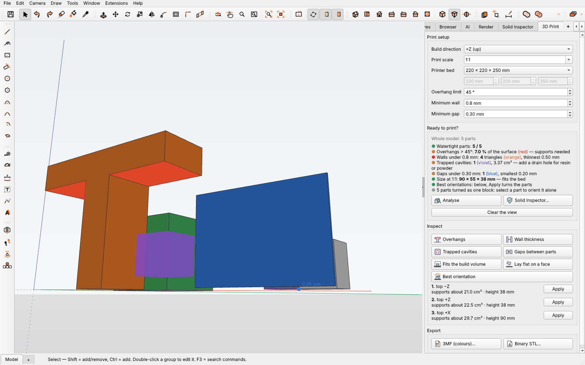

# Impression 3D — extension IngeTrazo

*English below.*



Prépare un modèle IngeTrazo pour une imprimante 3D : contrôles,
orientation, export. Panneau **Impression 3D** (onglet du volet latéral) et
menu **Extensions ▸ Impression 3D**.

**Réglages d'impression** — direction d'impression, échelle (1:1, 1:50 pour
un bâtiment…), plateau (formats courants ou personnalisé), limite de
surplomb, paroi minimale, jeu minimal. Toutes les mesures sont celles de
l'objet imprimé, à l'échelle choisie.

**Prêt à imprimer ?** — *Analyser* fait tous les contrôles sur les pièces
sélectionnées, ou sur tout le modèle quand rien n'est sélectionné (une
pièce = un groupe ; les personnages « face à moi » sont ignorés) :

| Contrôle | Ce qu'il montre |
|---|---|
| Pièces étanches | le décompte de l'Inspecteur de solides d'IngeTrazo, qui détaille et répare |
| Surplombs | en rouge, les faces trop inclinées qui demandent des supports (pas celles posées sur le plateau ni sur une autre pièce) |
| Épaisseur de paroi | en orange, les parois plus fines que le minimum, et la plus fine |
| Cavités fermées | en violet, les vides enfermés dans une pièce (résine ou poudre piégée), et leur volume |
| Jeux entre pièces | en bleu, les pièces plus proches que le jeu minimal (elles risquent de se souder) ; les contacts sont comptés à part |
| Tient sur le plateau | la taille imprimée, comparée au plateau, dessiné en pointillés autour des pièces |

Les contrôles ne font que **dessiner sur la vue** : le document ne change
pas. Chaque bouton *Inspecter* montre son propre résultat.

**Orienter** — *Orientation optimale* propose les trois façons de poser les
pièces qui demandent le moins de supports (surface et volume des supports,
hauteur d'impression ; une pose sur une arête passe après toute pose sur une
face). *Appliquer* tourne les pièces. *Poser sur une face*, puis un clic sur
une face, la pose sur le plateau. Chaque fois : **une seule étape
d'annulation**, et le point le plus bas reste à sa hauteur.

**Réparer** — *Voir les trous* dessine en orange le bord des trous des
pièces ; *Boucher tous les trous* les ferme en une étape d'annulation ;
*Boucher un trou* puis un clic près d'un bord ferme celui-là. *Rustine
lisse* : la rustine prolonge la courbure autour du trou (lissage
bi-harmonique, triangulation de Delaunay) ; *Bouchon plat* : un simple
bouchon. Un trou dans une face plane reçoit toujours une seule face plane.
Les trous se ferment dans la définition d'un composant (toutes ses copies).

**Remplissage gyroïde** — pour alléger une pièce : elle garde une peau
pleine d'épaisseur choisie et son intérieur devient un gyroïde (surface
minimale triplement périodique, auto-portante, sans supports internes).
Réglages en millimètres imprimés : taille de cellule, paroi du gyroïde,
peau (0 = gyroïde seul). *Appliquer à la sélection* range ces réglages dans
la pièce (enregistrés dans le .igz, une étape d'annulation) ; le gyroïde
n'est construit qu'à l'export, le modèle reste léger. *Aperçu en coupe*
le construit et en dessine une coupe à la hauteur choisie, avec la matière
gagnée. Peau fermée : en résine ou en poudre, prévoir des trous
d'évacuation. Le maillage et les opérations booléennes passent par
manifold3d, la bibliothèque qu'IngeTrazo livre pour ses outils solides.

**Exporter** — **3MF** (un objet par pièce, nommé comme le groupe, avec ses
couleurs ; la couleur moyenne d'une texture) ou **STL binaire**, en
millimètres, à l'échelle et dans l'orientation d'impression, posé à
l'origine. Les supports, eux, restent le travail du trancheur (slicer) :
il connaît la buse, la matière et l'imprimante.

Méthodes : normales et aires des triangles, rayons de Möller–Trumbore,
parité de rayon pour l'intérieur d'un solide, point le plus proche d'un
triangle, volumes signés ; une grille uniforme garde les recherches
locales. NumPy seul. Les faces masquées par le modèle sont cachées grâce à
la profondeur que la vue d'IngeTrazo a déjà calculée.

Installation : **Extensions ▸ Gérer les extensions…**, ou à la main : le
dossier `print3d` dans `%APPDATA%\ingetrazo\plugins\` (Windows) ou
`~/.local/share/ingetrazo/plugins/` (Linux), puis redémarrer IngeTrazo.

Panneau en français, anglais et espagnol, selon la langue d'IngeTrazo.

---

# 3D Print — IngeTrazo extension

Gets an IngeTrazo model ready for a 3D printer: checks, orientation,
export. A **3D Print** panel (a tab of the side tray) and an
**Extensions ▸ 3D Print** menu.

**Print setup** — build direction, print scale (1:1, 1:50 for a
building…), printer bed (common sizes or custom), overhang limit, minimum
wall, minimum gap. Every measure is the printed object's, at that scale.

**Ready to print?** — *Analyse* runs every check on the selected parts, or
on the whole model when nothing is selected (a part = a group; face-me
figures are left out):

| Check | What it shows |
|---|---|
| Watertight parts | the count from IngeTrazo's Solid Inspector, which explains and repairs |
| Overhangs | in red, faces leaning too far that need support (not those on the bed or resting on another part) |
| Wall thickness | in orange, walls thinner than the minimum, and the thinnest |
| Trapped cavities | in violet, voids closed inside a part (trapped resin or powder), and their volume |
| Gaps between parts | in blue, parts closer than the minimum gap (they may fuse); contacts are counted apart |
| Fits the build volume | the printed size against the bed, drawn dashed around the parts |

The checks only **draw over the view**: the document does not change.
Each *Inspect* button shows its own result.

**Orient** — *Best orientation* offers the three ways to stand the parts
that need the least support (support area and volume, print height; a
part balanced on an edge comes after any part on a face). *Apply* turns
them. *Lay flat on a face*, then a click on a face, puts that face on the
bed. Each time: **one undo step**, and the lowest point keeps its height.

**Repair** — *Show holes* draws the rims of the parts' holes in orange;
*Fill every hole* closes them in one undo step; *Fill one hole*, then a
click near a rim, closes that one. *Smooth patch*: the patch carries on
the curve around the hole (bi-harmonic fairing, Delaunay triangulation);
*Flat cap*: a plain cap. A hole in a flat face always gets one flat face.
A component's holes are closed in its definition (every copy).

**Gyroid infill** — to lighten a part: it keeps a solid skin of the chosen
thickness and its inside becomes a gyroid (a triply periodic minimal
surface, self-supporting, no inner supports). Settings in printed
millimetres: cell size, gyroid wall, skin (0 = gyroid only). *Apply to
the selection* stores them in the part (saved in the .igz, one undo
step); the gyroid is built only at export, so the model stays light.
*Preview a cut* builds it and draws a cut at the chosen height, with the
material saved. A closed skin traps resin or powder: add drain holes.
Meshing and booleans go through manifold3d, the library IngeTrazo ships
for its Solid Tools.

**Export** — **3MF** (one object per part, named after the group, with its
colours; a texture gives its mean colour) or **binary STL**, in
millimetres, at the print scale and orientation, at the origin. Supports
stay the slicer's job: it knows the nozzle, the material and the printer.

Methods: triangle normals and areas, Möller–Trumbore rays, ray parity for
inside a solid, closest point on a triangle, signed volumes; a uniform
grid keeps the searches local. NumPy only. Faces hidden by the model are
left out using the depth IngeTrazo's view already rendered.

## Development

```
pip install -r <IngeTrazo>/requirements.txt pytest lib3mf
INGETRAZO_SRC=<IngeTrazo> python -m pytest tests
python tools/build_zip.py      # dist/print3d-<version>.zip and its SHA-256
```

`lib3mf` (the 3MF Consortium's library) only reads the files back in the
tests. The tests inside IngeTrazo need its sources (`INGETRAZO_SRC`).

GPL-3.0-or-later — © 2026 Nicolas Marc.
